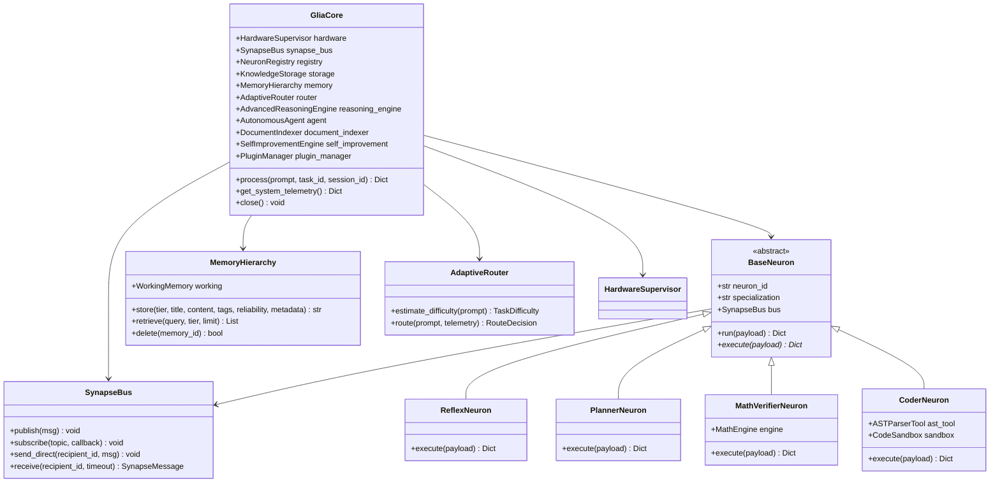

# GliaCore 0.3.0 — Comprehensive Architectural Specification

This document details the internal architecture, biological foundations, subsystem contracts, memory topologies, and communication pathways of **GliaCore 0.3.0** (formerly PROJECT: NEURON).

---

## 1. System Overview & Biological Paradigm

GliaCore is inspired by modern neurobiology. In mammalian central nervous systems, neurons do not compute in isolation. They depend entirely upon the **glial astrocyte network**, which regulates metabolic energy, clears toxic byproducts, modulates synaptic transmission, and coordinates synchrony across disparate cortical regions.

In GliaCore:
1. **Specialized Computational Units (Neurons):** Small, focused modules responsible for reflex filtering, mathematical analysis, code synthesis, or high-level planning.
2. **Binary Communication Pathways (Synapses):** High-speed, typed, binary-serialized channels using MessagePack over in-memory buses or inter-process pipes.
3. **The GliaCore Orchestrator (Astrocyte Nexus):** Central engine that monitors GPU VRAM and System RAM budgets, dynamically computes task difficulty, schedules cognitive planning, and consolidates memory across long-term tiers.
4. **Deterministic Tool Offloading:** Mathematical, syntactic, or algorithmic queries are resolved deterministically (SymPy, AST parsing, SQLite FTS) rather than relying on probabilistic SLM hallucinations.
5. **Hardware Safety Guardrail:** The `HardwareSupervisor` strictly enforces a **3,500 MB usable VRAM** boundary on consumer GPUs (e.g. NVIDIA RTX 2050 4GB VRAM) to guarantee zero out-of-memory crashes.

---

## 2. Core Subsystems

### Subsystem 1: Hardware Supervisor (`gliacore.core.hardware`)
- **Role:** Tracks physical and usable VRAM on CUDA devices and system RAM.
- **Safety Boundary:** Enforces a 500 MB reserve buffer below the 3,500 MB usable ceiling on 4GB GPUs.
- **Cache Management:** Performs PyTorch CUDA cache clearing and garbage collection automatically.

### Subsystem 2: Foundation Model Runner (`gliacore.core.model_runner`)
- **Role:** Manages local SLMs (Qwen2.5-0.5B, Qwen2.5-1.5B) within memory budgets.
- **Fallback Policy:** Detects offline mode via `local_files_only=True` and falls back gracefully to high-performance neural-symbolic execution when model binaries are not pre-downloaded.

### Subsystem 3: Binary Synapse Bus (`gliacore.synapse.bus`)
- **Role:** Sub-millisecond typed communication layer using MessagePack binary serialization.
- **Topologies:** Supports both 1-to-many publish-subscribe topics and point-to-point addressed mailboxes.

### Subsystem 4: Reflex & Security Neuron (`gliacore.neurons.reflex`)
- **Role:** Deterministic regex pre-screening executing in $<0.2$ ms.
- **Coverage:** Intercepts command injection (`rm -rf`, `mkfs`, PowerShell escapes, fork bombs) before reasoning or model execution begins.

### Subsystem 5: Adaptive Neural Router (`gliacore.routing.router`)
- **Role:** Dynamically estimates task complexity score ($0.0$ to $1.0$).
- **Routing Tiers:**
  - `SIMPLE`: Dispatches directly to specialist neurons (~1.5 ms latency).
  - `MODERATE`: Activates generate-and-verify reflection loop (~20–50 ms latency).
  - `COMPLEX`: Deploys multi-stage cognitive planning DAG and full memory retrieval (~80–180 ms latency).

### Subsystem 6: Cognitive Planner Neuron (`gliacore.neurons.planner`)
- **Role:** Decomposes complex tasks into ordered execution stages with dependency graphs.

### Subsystem 7: Mathematical Intelligence Unit (`gliacore.neurons.math_verifier`)
- **Role:** Offloads arithmetic and algebraic equations to the deterministic **SymPy** symbolic engine. Guarantees 0% hallucination on multi-digit mathematics.

### Subsystem 8: Code Synthesis & Verification Unit (`gliacore.neurons.coder`)
- **Role:** Combines code generation with Python Abstract Syntax Tree (AST) pre-screening and subprocess sandboxing with a 5.0s timeout.

### Subsystem 9: Advanced Reasoning & Reflection Engine (`gliacore.reasoning.engine`)
- **Role:** Executes generate-and-verify reflection cycles. Automatically detects and corrects syntax errors and unbalanced expressions before final output generation.

### Subsystem 10: 4-Tier Memory Hierarchy (`gliacore.memory.hierarchy`)
- **Tiers:** Working Memory (transient scratchpad), Episodic Memory (past solution histories), Semantic Memory (curated facts), Procedural Memory (executable tool recipes).
- **Features:** Multi-factor relevance scoring, time decay, deduplication, and SQLite WAL persistence.

### Subsystem 11: Controlled Autonomous Agent (`gliacore.agent.planner`)
- **Role:** Manages long-horizon multi-step goals as Directed Acyclic Graphs (DAGs) with atomic state checkpoints and immediate user cancellation.

### Subsystem 12: Local Web Server & REST API (`gliacore.ui.server`)
- **Role:** Asynchronous `aiohttp` web server providing REST API endpoints and serving the single-page responsive **GliaCore Studio** web UI.
