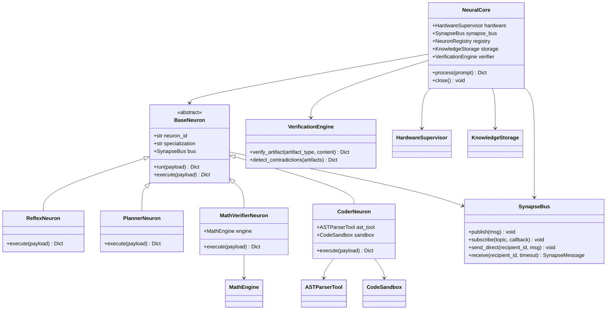
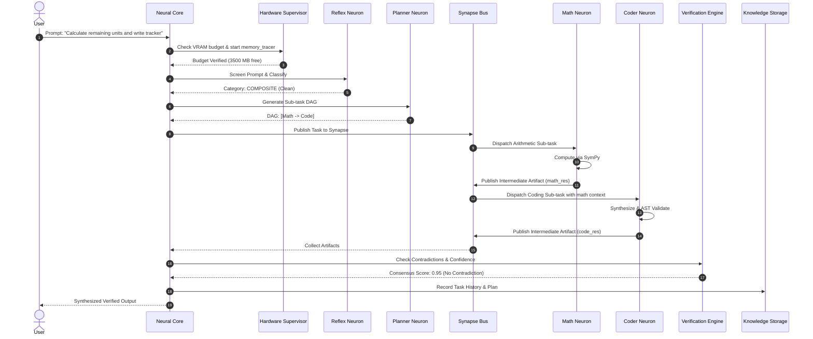

# NEURON Architectural Specification

This document details the internal design, component contracts, memory topologies, and communication pathways of **PROJECT: NEURON**.

---

## 1. System Overview & Principles

PROJECT: NEURON is architected around four core design tenets:
1. **Biological Specialization over Monolithic Generality**: Rather than expecting a single Small Language Model (SLM) to compute math, compile code, organize multi-step plans, and filter malicious instructions, NEURON establishes a network of distinct, specialized computational units (**Neurons**).
2. **Binary Synapse Communication**: Communication between neurons occurs via typed, binary-serialized packets (`SynapseMessage`) using MessagePack. JSON-over-HTTP overhead is strictly eliminated within the internal execution loop.
3. **Deterministic Tool Offloading**: Capabilities that can be solved mathematically, syntactically, or algorithmically are offloaded to deterministic tools (`SymPy`, `ast`, isolated sandboxes). Stochastic generation is reserved purely for high-level semantic reasoning.
4. **Hardware-Guarded Execution**: Every execution step is bounded by the `HardwareSupervisor`, which enforces a **3,500 MB usable VRAM** ceiling on the host NVIDIA RTX 2050 GPU, preventing out-of-memory crashes.

---

## 2. The 12 Core Subsystems

### Subsystem 1: Hardware Supervisor & VRAM Budget Controller (`neuron.core.hardware`)
- **Role**: Continuously tracks GPU VRAM and System RAM telemetry.
- **Invariants**:
  - Maximum usable VRAM: `3,500.0 MB` (accounting for ~1,000 MB Windows 11 Desktop Window Manager overhead).
  - Safety Buffer: `500.0 MB` hard reserve to absorb PyTorch dynamic activation spikes.
  - Context Manager `memory_tracer`: profiles start, end, and peak VRAM/RAM allocations during task execution.
  - Dynamic Fallback: if `can_allocate_vram(required_mb)` evaluates to `False`, the workload is rerouted to CPU execution.

### Subsystem 2: Synapse Binary Protocol (`neuron.synapse.messages`)
- **Serialization**: MessagePack binary protocol (`msgpack`).
- **Data Structure**:
  - `message_id`: UUIDv4
  - `timestamp`: Unix epoch float
  - `msg_type`: Enum (`TASK_REQUEST`, `INTERMEDIATE_ARTIFACT`, `SYNAPSE_SIGNAL`, `VERIFICATION_VOTE`, `HEARTBEAT`)
  - `sender_id` & `recipient_id`: string identifiers
  - `topic`: Pub/Sub channel key (e.g., `neuron.math`, `neuron.code`)
  - `payload`: arbitrary dictionary containing intermediate tensors, code trees, or values.

### Subsystem 3: Synapse Event Bus (`neuron.synapse.bus`)
- **Concurrency**: Thread-safe in-memory message queues (`queue.Queue`) per registered neuron.
- **Patterns**:
  - **Direct Point-to-Point**: `send_direct(recipient, msg)` places message into targeted neuron mailbox.
  - **Topic-Based Pub/Sub**: `publish(msg)` broadcasts to all neurons subscribed to topic prefixes.
- **Backpressure & Telemetry**: Tracks total messages routed, dropped, and queue depth.

### Subsystem 4: Working Memory (`neuron.memory.working`)
- **Role**: Short-term execution scratchpad bound to an individual `task_id`.
- **Contents**:
  - Ordered artifact log (`WorkingArtifact`) recording producing neuron, artifact type, confidence score, and raw payload.
  - Key-value state dictionary for sharing variables across neurons.
  - Automatically flushed or distilled upon task completion.

### Subsystem 5: Long-Term Knowledge Storage (`neuron.memory.storage`)
- **Role**: Persistent multi-session memory backed by SQLite (`sqlite3`).
- **Features**:
  - Full-Text Search (FTS5) for keyword and token indexing.
  - Normalized vector storage for semantic retrieval via cosine similarity.
  - Task execution history table logging prompts, categories, plan DAGs, latency, and status.

### Subsystem 6: Reflex & Intent Guardrail Neuron (`neuron.neurons.reflex`)
- **Latency**: &le; 1 ms.
- **Responsibilities**:
  - Immediate lexical and pattern-based classification of incoming prompts into `MATH`, `CODE`, `PLANNING`, `COMPOSITE`, or `GENERAL`.
  - Security screening: intercepts destructive commands (e.g. `rm -rf /`, shell injection, memory bypass attempts) and immediately returns `BLOCKED`.

### Subsystem 7: Cognitive Planner Neuron (`neuron.neurons.planner`)
- **Responsibilities**:
  - Decomposes complex compound requests into a Directed Acyclic Graph (DAG) of sub-tasks.
  - Assigns dependencies between specialized neurons (e.g., executing Math before Code generation for data-driven algorithms).

### Subsystem 8: Mathematical Intelligence & Verifier Neuron (`neuron.neurons.math_verifier`)
- **Engine**: SymPy symbolic solver and arithmetic evaluator (`neuron.tools.math_engine`).
- **Capabilities**:
  - Arbitrary-precision rational arithmetic.
  - Algebraic equation solving (`solve()`).
  - Polynomial roots, trigonometry, calculus, and matrix operations.
  - Evaluates and verifies mathematical claims generated by language models.

### Subsystem 9: Code Intelligence & AST Neuron (`neuron.neurons.coder`)
- **Engine**: Python `ast` module and `CodeSandbox` (`neuron.tools.ast_parser`, `neuron.tools.code_sandbox`).
- **Capabilities**:
  - Static AST analysis to verify syntax correctness before code execution.
  - Extraction of functions, classes, imports, and docstrings.
  - Sandboxed execution in a controlled subprocess with strict timeouts to verify runtime behavior.

### Subsystem 10: Consensus & Verification Engine (`neuron.verification.consensus`)
- **Role**: The adjudicator for multi-neuron collaborative pipelines.
- **Mechanism**:
  - Inspects all intermediate artifacts produced during a task.
  - Evaluates confidence scores and cross-checks for semantic or numerical contradictions.
  - Computes a weighted `consensus_score` (&isin; [0.0, 1.0]).
  - Flags `contradiction_detected` if disparate neurons produce conflicting facts.

### Subsystem 11: Neuron Registry (`neuron.core.registry`)
- **Role**: Dynamic discovery and lifecycle management.
- **Methods**: `register()`, `deregister()`, `get()`, `find_by_specialization()`, `list_all()`.

### Subsystem 12: Neural Core Orchestrator (`neuron.core.engine`)
- **Role**: The master pipeline coordinating pre-flight hardware inspection, reflex screening, planner routing, synapse message dispatch, verification, and long-term memory indexing.

---

## 3. Communication Sequence Diagram

---

## 4. Hardware Safety Guarantees

1. **Zero OOM Invariant**: PyTorch CUDA allocations are guarded by `can_allocate_vram(required_mb)`.
2. **Deterministic Purging**: The `HardwareSupervisor.purge_cache()` triggers `gc.collect()`, `torch.cuda.empty_cache()`, and `torch.cuda.ipc_collect()` after heavy operations.
3. **RAM Ceiling**: System RAM is monitored via `psutil`. If visible free RAM drops below 1,500 MB, the system throttles background processes to protect operating system stability.
