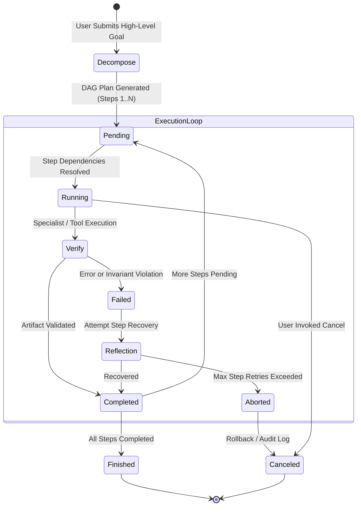

# AUTONOMOUS EXECUTION — Controlled Multi-Step Agent Architecture

## 1. Executive Summary

Autonomous AI agents that execute unconstrained loops or broad shell commands present unacceptable security and stability risks on local edge hardware. 

PROJECT: NEURON 0.3.0 implements a **Controlled Autonomous Task Execution Agent** (`src/neuron/agent/planner.py`). The agent decomposes high-level user goals into structured Directed Acyclic Graphs (DAGs) of executable sub-tasks, enforcing deterministic step validation, progress monitoring, state checkpointing, and immediate user cancellation.

---

## 2. DAG Decomposition & Execution Lifecycle



### Plan Generation & Step Representation
Each decomposed step within the DAG is formally represented as an `AgentStep`:

```python
@dataclass
class AgentStep:
    step_id: str
    description: str
    tool_or_neuron: str
    parameters: Dict[str, Any]
    dependencies: List[str]  # IDs of prior steps required before execution
    status: StepStatus       # PENDING, RUNNING, COMPLETED, FAILED, SKIPPED
    result: Optional[Any] = None
    error: Optional[str] = None
```

The planner analyzes dependencies to identify the optimal execution sequence, executing independent steps concurrently across the Synapse bus when resources permit.

---

## 3. Checkpointing & State Persistence

To guard against process interruption or sudden resource exhaustion:
1. **Periodic Checkpoints**: After each step transition (`PENDING` $\to$ `COMPLETED`), the agent serializes its complete execution graph, accumulated artifacts, and working memory to `WorkingMemory`.
2. **Audit Logging**: Every action, tool argument, execution duration, and intermediate output is appended to an in-memory auditable execution log.
3. **Resumption & Rollback**: If a step encounters an unrecoverable failure, the agent isolates the failure to that specific DAG branch without corrupting previously verified artifacts.

---

## 4. Safety Guardrails & Cancellation Protocols

The autonomous agent is subject to strict operational boundaries:
- **No Unsafe Execution**: The agent cannot execute raw shell commands, delete filesystem directories, or access unapproved network ports. All tool calls route through verified NEURON tools (`MathEngine`, `ASTParserTool`, `CodeSandbox`, `DocumentIndexer`, `RepoExplorer`).
- **Immediate User Cancellation**: The agent exposes an atomic `.cancel_plan(plan_id)` method. Active execution threads check cancellation flags between sub-step dispatches, guaranteeing sub-second halting.
- **Sub-step Timeouts**: Every individual step execution is bounded by a strict timeout (default: 10.0 seconds). If a step exceeds its timeout, it is terminated and marked as `FAILED`.

---

## 5. REST API & UI Integration

The autonomous agent is directly accessible via the interactive chat UI (Agent Workspace) and dedicated REST endpoints:
- `POST /api/agent/plan`: Decomposes a user goal into a preview DAG plan.
- `POST /api/agent/execute`: Initiates controlled execution of an approved plan.
- `GET /api/agent/status?plan_id=...`: Retrieves real-time step progress and logs.
- `POST /api/agent/cancel`: Halts active execution immediately.
