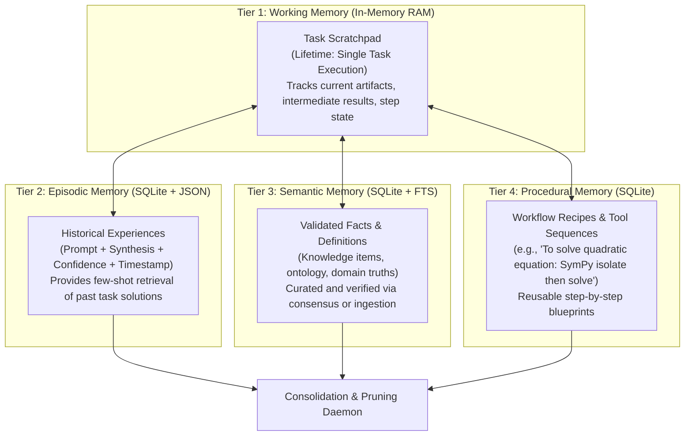

# MEMORY EVOLUTION — 4-Tier Hierarchical Knowledge Architecture

## 1. Executive Summary

PROJECT: NEURON 0.3.0 replaces naive single-table key-value storage with a **4-Tier Memory Hierarchy** (`src/neuron/memory/hierarchy.py`). Edge-optimized AI architectures cannot maintain an infinite context window or fine-tune multi-gigabyte models on a 4 GB VRAM GPU. 

NEURON decouples persistent knowledge and execution history into four specialized, structured memory tiers designed to store, score, retrieve, and consolidate experience over time.

---

## 2. The 4-Tier Memory Hierarchy



### Tier 1: Working Memory (`WorkingMemory`)
- **Scope**: Transient, thread-local in-memory state for an individual active task.
- **Components**: Task ID, current execution stage, intermediate artifacts (math outputs, code ASTs), blackboard key-values, and verification flags.
- **Lifecycle**: Initialized at task launch, synthesized into the final response, and cleared from RAM upon task completion.

### Tier 2: Episodic Memory
- **Scope**: Long-term record of completed user interactions and problem-solving attempts.
- **Payload**: Full task prompt, final synthesized output, consensus score, task duration, and execution metadata.
- **Use Case**: Allows NEURON to recognize repeated or similar queries and reuse verified conclusions without redundant planning.

### Tier 3: Semantic Memory
- **Scope**: Persistent, authoritative repository of verified facts, definitions, equations, and domain knowledge.
- **Payload**: Concept title, canonical definition/fact string, categorical tags, and reliability score.
- **Use Case**: Populated via user documents (via Document Indexer) or pre-loaded domain knowledge (e.g. quantization techniques, hardware specifications).

### Tier 4: Procedural Memory
- **Scope**: Execution recipes, tool chaining strategies, and algorithmic procedures.
- **Payload**: Workflow name, step-by-step tool invocation recipe, parameter guidelines, and success rate.
- **Use Case**: Guides the Cognitive Planner when decomposing recurring composite tasks.

---

## 3. Multi-Factor Retrieval Ranking

When a query is received, NEURON searches across relevant memory tiers. Retrieved memory items are scored and ranked using a **Multi-Factor Ranking Formula**:

$$\text{Final Score}(m) = S_{\text{relevance}}(m, q) \times S_{\text{recency}}(m) \times S_{\text{reliability}}(m)$$

### A. Relevance Score ($S_{\text{relevance}}$)
Computed using Jaccard word-overlap and keyword density between query tokens $Q$ and memory content tokens $M$:

$$S_{\text{relevance}} = \frac{|Q \cap M|}{|Q|}$$

### B. Recency Score ($S_{\text{recency}}$)
Applies exponential time-decay to favor recently refreshed or verified entries:

$$S_{\text{recency}} = e^{-\lambda \cdot \Delta t}$$

Where $\Delta t$ is elapsed time in days and $\lambda = 0.05$. Older memories naturally attenuate unless frequently re-accessed.

### C. Reliability Score ($S_{\text{reliability}}$)
Directly incorporates the historical consensus score $R \in [0.0, 1.0]$. Items verified through deterministic tools (SymPy, AST) carry $R = 1.0$; unverified model generations carry $R = 0.5$ to $0.7$.

---

## 4. SQLite Schema & Concurrency Safety

All persistent tiers reside in `neuron_memory.db` governed by strict safety guarantees:
- **Write-Ahead Logging (WAL)**: `PRAGMA journal_mode = WAL` allows non-blocking concurrent readers during writes.
- **Synchronous Normal**: `PRAGMA synchronous = NORMAL` protects against database corruption while maximizing edge NVMe throughput.
- **Thread Re-entrancy**: All SQLite cursors and commits are wrapped in Python `threading.RLock()` to prevent deadlocks under high-concurrency multi-threaded queries.

```sql
CREATE TABLE IF NOT EXISTS memories (
    memory_id TEXT PRIMARY KEY,
    tier TEXT NOT NULL,
    title TEXT NOT NULL,
    content TEXT NOT NULL,
    tags_json TEXT,
    reliability_score REAL NOT NULL,
    access_count INTEGER DEFAULT 0,
    created_at REAL NOT NULL,
    updated_at REAL NOT NULL,
    metadata_json TEXT
);

CREATE INDEX IF NOT EXISTS idx_memories_tier ON memories (tier);
CREATE INDEX IF NOT EXISTS idx_memories_reliability ON memories (reliability_score);
```

---

## 5. Memory Consolidation Daemon

To prevent unbounded database growth on edge hardware, `MemoryHierarchy.consolidate(max_items_per_tier=500)` runs periodically:
1. **Tier Cap Enforcement**: If any tier exceeds 500 items, excess items are ranked and pruned.
2. **Pruning Priority**: Entries with the lowest reliability score, lowest access count, and oldest update timestamps are pruned first.
3. **Deduplication**: When storing an entry with an existing title in the same tier, NEURON updates the content, refreshes the timestamp, and bumps the reliability score rather than inserting a duplicate record.
