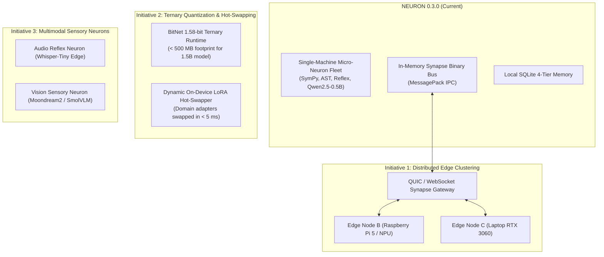

# PHASE 3 ROADMAP — Evolutionary Horizons & Phase 4 Vision

## 1. Architectural Trajectory

With PROJECT: NEURON 0.3.0, the core collective intelligence platform has established:
- Hardware-bounded execution ($\le 3,500$ MB VRAM on RTX 2050)
- Adaptive difficulty-calibrated routing
- Multi-stage generate-and-verify reflection loops
- 4-tier structured memory hierarchy
- Autonomous multi-step DAG execution
- Extensible plugin framework
- Interactive 6-workspace web UI

The next evolutionary horizon (**PROJECT: NEURON 0.4.0 / Phase 4**) focuses on **Distributed Edge Clustering, Ternary Weight Quantization, and Multimodal Sensory Expansion**.

---

## 2. Phase 4 Core Initiatives

---

## 3. Detailed Phase 4 Technical Roadmap

### 1. Distributed Edge Clustering (Cross-Device Synapses)
- **Objective**: Scale the neuron fleet across local local-area networks (LAN) without cloud dependencies.
- **Protocol**: High-throughput binary messaging over QUIC / WebSockets with mutual TLS (mTLS) authentication.
- **Capability**: A low-power Raspberry Pi 5 running Reflex and Document Indexing can offload heavy AST or model inference tasks to the HP Victus RTX 2050 via Synapse channels seamlessly.

### 2. Ternary Quantization & 1.58-bit Weights (BitNet Integration)
- **Objective**: Reduce model VRAM footprint from 1,000 MB down to under **350 MB** for a 1.5B parameter model.
- **Target Formats**: BitNet b1.58 and EXL2 2.2-bit quantization formats.
- **Impact**: Enables running multiple specialized foundation model neurons concurrently in 4 GB VRAM without dynamic unloading.

### 3. Dynamic On-Device LoRA Adapter Hot-Swapping
- **Objective**: Instantaneously specialize a base 0.5B model for specific tasks (legal, biomedical, coding) without loading separate base models.
- **Latency Target**: Hot-swap 4-bit LoRA rank-16 weight deltas in under **5.0 milliseconds** directly in GPU memory.

### 4. Multimodal Sensory Neurons
- **Sensory Audio**: Integration of an edge Whisper-Tiny model as an acoustic reflex neuron for real-time voice command parsing and speech-to-intent dispatch.
- **Sensory Vision**: Local integration of lightweight vision micro-models (e.g. Moondream2 or SmolVLM) for on-device diagram and UI wireframe understanding.

### 5. Automated Reinforcement Learning from Experience (RL-E)
- **Objective**: Convert verified episodic memories directly into preference optimization pairs (DPO) for on-device overnight fine-tuning.
- **Safety Gate**: Strict consensus thresholds ($R \ge 0.95$) to guarantee only formally verified solutions generate training gradients.

---

## 4. Release Timeline

| Milestone | Target Version | Focus Areas | Target Release |
|---|---|---|---|
| **Phase 3 Release** | `0.3.0` | Adaptive Routing, Reasoning Loop, 4-Tier Memory, 6-Workspace UI | **Immediate (Current)** |
| **Phase 3.1 Patch** | `0.3.1` | Enhanced Document Indexer FTS5 ranking, additional benchmark tasks | Q1 2027 |
| **Phase 4 Alpha** | `0.4.0-alpha` | Distributed Synapse over QUIC, multi-node discovery | Q2 2027 |
| **Phase 4 Beta** | `0.4.0-beta` | BitNet b1.58 ternary runtime, LoRA hot-swapping | Q3 2027 |
| **Phase 4 GA** | `0.4.0` | Production Distributed Collective Intelligence Platform | Q4 2027 |
