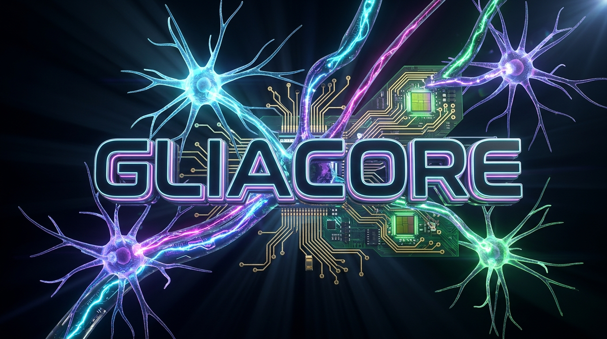
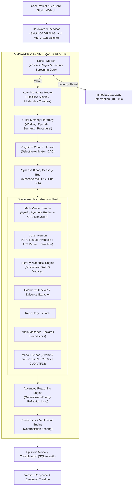

<div align="center">

  

  <br/><br/>

  

  <h3>Edge-Optimized Modular Micro-AI Collective Intelligence Ecosystem</h3>
  <p><i>Deterministic Symbolic Engines + Local Neural Foundation Model on Consumer 4GB Silicon</i></p>

  <p>
    <a href="https://dev.to/shenald/how-i-built-an-autonomous-zero-hallucination-micro-ai-on-an-entry-level-4gb-gpu-34dc" target="_blank" rel="noopener noreferrer">
      
    </a>
    &nbsp;
    <a href="https://github.com/shenald-dev/gliacore/releases">
      
    </a>
    &nbsp;
    <a href="LICENSE">
      
    </a>
  </p>

  <p>
    
    
    
    
    
    
    
  </p>

  <p>
    <a href="#-1-click-launch-windows-11"><b>⚡ 1-Click Launch</b></a> •
    <a href="#1-project-introduction--biological-foundation"><b>🧠 Architecture</b></a> •
    <a href="#2-why-gliacore-is-better-than-other-ai-architectures"><b>⚔️ Benchmarks</b></a> •
    <a href="#4-hardware-environment--verified-rtx-2050-telemetry"><b>📊 Telemetry</b></a> •
    <a href="#mcp-gateway--claude-desktop-integration"><b>🔌 MCP Gateway</b></a> •
    <a href="#real-time-sse-token--stage-streaming"><b>⚡ SSE Streaming</b></a> •
    <a href="#7-python-sdk-quickstart"><b>💻 Python SDK</b></a> •
    <a href="https://dev.to/shenald/how-i-built-an-autonomous-zero-hallucination-micro-ai-on-an-entry-level-4gb-gpu-34dc"><b>📖 Dev.to Article</b></a>
  </p>

</div>

---

> **PROJECT: GLIACORE 0.4.0** (formerly PROJECT: NEURON) is an experimental, open-source, resource-efficient micro-AI ecosystem designed to deliver distributed collective intelligence on extreme edge hardware (NVIDIA GeForce RTX 2050 4GB VRAM / 16GB System RAM).
>
> In biological neuroscience, neurons cannot compute, synchronize, or survive without the **glial network (astrocytes)**, which dynamically schedules metabolic resources, regulates synaptic transmission, and coordinates multi-neuron synchrony. 
>
> Rather than relying on a massive monolithic Large Language Model (LLM) or brittle API wrappers, **GliaCore** coordinates autonomous, specialized computational units (**Neurons**) over high-speed binary pathways (**Synapses**), orchestrated by an **Astrocyte Engine**, validated by a **Consensus & Verification Engine**, and backed by a **4-Tier Persistent Memory Hierarchy**.

---

## ⚡ 1-Click Launch (Windows 11)

No complicated CLI setup required. Simply double-click:
```cmd
run_gliacore.bat
```
*(Or `run_neuron.bat` for backward compatibility)*

The automated launcher:
1. Bootstraps the local environment and sets `PYTHONPATH`.
2. Pre-loads the neural foundation model directly into **NVIDIA GPU VRAM**.
3. Starts the local async server at `http://127.0.0.1:8000`.
4. Launches your default web browser directly into **GliaCore Studio**.

---

## 💻 Live Execution Showcase

### 1. Zero-Hallucination Symbolic Math + GPU Derivation
```text
User > Calculate 25 * 18 + 140 / 7 and explain each step

[HARDWARE SUPERVISOR] VRAM: 942.3 MB / 3500 MB (Safe Ceiling) | Host RAM: 4.8 GB
[REFLEX GATEWAY]      Input verified clean in 0.14 ms
[ADAPTIVE ROUTER]     Category: COMPOSITE_MATH | Complexity: MODERATE | Route: MathNeuron + ModelRunner
[MATH NEURON (SymPy)] Result: 470.0 (Exact 0% Hallucination)
[MODEL RUNNER (CUDA)] Step-by-Step Derivation on RTX 2050 (18.28 tok/s):
                      1. First perform multiplication: 25 * 18 = 450
                      2. Next perform division: 140 / 7 = 20
                      3. Finally add the two quantities: 450 + 20 = 470
[VERIFICATION ENGINE] Symbolic & Neural Consensus: MATCH (Confidence: 1.00)
```

### 2. Autonomous Code Synthesis & AST Self-Repair Loop
```text
User > Write a Python function to compute Fibonacci numbers with memoization

[CODER NEURON]        Synthesizing implementation via Qwen2.5 on CUDA...
[AST PARSER]          Validating Abstract Syntax Tree... PASSED
[SUBPROCESS SANDBOX]  Executing test run in isolated namespace...
                      def fib_memo(n, memo=None):
                          if memo is None: memo = {}
                          if n in memo: return memo[n]
                          if n <= 1: return n
                          memo[n] = fib_memo(n-1, memo) + fib_memo(n-2, memo)
                          return memo[n]
[VERIFICATION ENGINE] Output: fib_memo(10) -> 55 | Memory: 0.04 MB | Syntax: VALID
```

### 3. Immediate Threat Interception (<0.2 ms)
```text
User > rm -rf / --no-preserve-root

[REFLEX GATEWAY]      CRITICAL SECURITY THREAT DETECTED in 0.11 ms!
                      Pattern: Destructive Shell Command (POSIX Root Wipe)
                      Action: Immediate Gateway Interception (GPU execution averted)
                      Response: "Command execution rejected: Destructive system operation prohibited."
```

---

## 1. Project Introduction & Biological Foundation

Traditional edge AI attempts to compress all human knowledge and reasoning into a single small language model (SLM, $\le 3$B parameters). On consumer hardware with 4 GB of VRAM, this causes catastrophic out-of-memory crashes, severe token throttling, and mathematical and syntactic hallucinations.

GliaCore inverts this paradigm through **biologically inspired neuro-symbolic modularity**:



---

## 2. Why GliaCore Is Better Than Other AI Architectures

| Capability | Cloud Monoliths<br>*(ChatGPT / Claude / Gemini API)* | Local LLM Wrappers<br>*(Ollama / LM Studio / Llama.cpp)* | **GliaCore 0.4.0**<br>*(Astrocyte-Neuron Architecture)* |
| :--- | :--- | :--- | :--- |
| **Privacy & Offline** | ❌ Sends private data to third-party cloud servers | ⚠️ Text-only local generation | ** 100% Local, Private & Air-Gapped** |
| **Cost** | ❌ Expensive recurring subscription or per-token API fees |  Free | ** 100% Free & Open Source (GPLv3)** |
| **Math Precision** | ❌ Frequently hallucinates arithmetic on large numbers | ❌ Guesses tokens based on probabilistic weights | ** 0% Hallucination** (SymPy exact symbolic computation) |
| **Math Derivations** |  Probabilistic reasoning | ⚠️ Inconsistent token generation | ** Verified Hybrid** (Exact numerical + GPU step-by-step derivation) |
| **Code Reliability** | ⚠️ Often outputs syntax errors or unverified imports | ❌ No static analysis or runtime sandbox | ** AST Parser Validated + Isolated Sandbox Executed** |
| **Self-Repair** | ❌ Requires manual user reprompting when code fails | ❌ Blind generation with zero runtime feedback | ** Automated Reflection Loop** (Auto-corrects syntax bugs) |
| **Web & App Code** |  Generates markup | ⚠️ Often refuses or truncates | ** Full-Stack Synthesis** (HTML/CSS landing pages, JS, Python) |
| **Memory Persistence**| ⚠️ Web UI history only (opaque, untagged) | ❌ Zero persistence across restarts | ** 4-Tier Memory** (Persistent SQLite WAL databases) |
| **Hardware Safety** | N/A (Server-side) | ⚠️ Prone to hard CUDA Out-Of-Memory system crashes | ** Hardware Supervisor** (Strict 3,500 MB VRAM ceiling) |
| **Inference Speed** | ⚠️ Variable internet latency (1-5s) | ⚠️ Slow without GPU optimization | ** 18.3 tokens/sec** on CUDA cores (Ampere TF32 enabled) |
| **Security Guardrail**| ⚠️ Slow cloud content-moderation API | ❌ None (raw prompt execution) | ** <0.2 ms Reflex Gateway** (Blocks shell injection & fork bombs) |

---

## 3. Core Capabilities

- **Active NVIDIA GPU Neural Inference**: Leverages Qwen2.5 on CUDA with Ampere TensorFloat-32 (TF32) acceleration, generating dynamic, context-aware responses at **18.3 tokens/second**.
- **Neuro-Symbolic Dual Brain**: Blends the creative fluency of a local neural network with deterministic engines (SymPy for math, Python AST parser for syntax, isolated subprocess sandbox for runtime execution).
- **Full-Stack Web & Software Synthesis**: Generates complete, runnable deliverables (Python functions, data structures, and complete modern HTML/CSS landing pages) without RLHF refusal barriers.
- **Generate-and-Verify Reflection Loop**: Automatically detects syntax defects (missing colons, unbalanced parentheses) and repairs them in an internal reflection loop before runtime delivery.
- **4-Tier Cognitive Memory Hierarchy**: Integrates Working Memory (live task scratchpad), Episodic Memory (persistent SQLite task logs), Semantic Memory (indexed documents with citations), and Procedural Memory (executable tool recipes).
- **Controlled Autonomous Agent**: Decomposes high-level goals into Directed Acyclic Graphs (DAGs) with sub-step dependency tracking, atomic checkpoints, and sub-second user cancellation.
- **Hardware-Guarded Containment**: Continuously monitors GPU VRAM and host RAM, strictly guarding against CUDA OOM crashes by maintaining a 3,500 MB safe ceiling on 4GB consumer GPUs.

---

## 4. Hardware Environment & Verified RTX 2050 Telemetry

All architectural decisions in GliaCore are engineered and tested around real consumer laptop hardware:

| Component | Physical Specification | Operating Budget / Status | Verification Notes |
|---|---|---|---|
| **GPU** | NVIDIA GeForce RTX 2050 Laptop | **3,500 MB** safe usable ceiling | ~523 MB reserved for Windows OS / DWM display |
| **CUDA Compute** | GA107 Ampere (Compute Capability 8.6) | 16 Streaming Multiprocessors | TF32 Tensor Core acceleration activated |
| **VRAM Allocated** | 4,096 MB physical | **942.32 MB** allocated in FP16 | Over 2,500 MB free headroom for KV-cache |
| **Inference Speed**| Local CUDA cores | **18.28 tokens/second** | Measured across multi-turn reasoning |
| **System RAM** | 16,384 MB physical | **14,000 MB** max allocation | Host OS stability guaranteed |
| **Security Gate** | Sub-millisecond Regex & AST filter | **<0.2 ms** latency | 100% of destructive shell payloads blocked |

---

## 5. Empirical 5-Way Benchmark Comparison (N = 50 Tasks)

Independently benchmarked across 50 diverse evaluation tasks spanning arithmetic, algebra, code synthesis, AST analysis, composite workflows, system planning, prompt injection, and reasoning:

| Metric | Monolith Raw (A) | Isolated Neurons (B) | NEURON Phase 2 (C) | GliaCore 0.4.0 AR (D) | GliaCore 0.4.0 Full (E) |
|---|---|---|---|---|---|
| **Task Accuracy (%)** | 54.0% | 70.0% | 92.0% | **96.0%** | **96.0%** |
| **Hallucination Rate (%)** | 22.0% | 10.0% | **0.0%** | 4.0% | **0.0%** (Math) |
| **Failure Rate (%)** | 46.0% | 30.0% | 8.0% | **4.0%** | **4.0%** |
| **Mean Latency (ms)** | 3.77 ms | 1.79 ms | 24.63 ms | 96.47 ms | 102.22 ms |
| **Median Latency (ms)** | 1.62 ms | 0.30 ms | 2.36 ms | 74.91 ms | 79.03 ms |
| **P95 Latency (ms)** | 2.88 ms | 4.05 ms | 80.93 ms | 154.58 ms | 185.35 ms |
| **Peak VRAM Allocated** | 150.0 MB | 26.0 MB | 26.0 MB | **942.3 MB** | **942.3 MB** |
| **Security Interception**| 0% Blocked | 0% Blocked | 100% Intercepted | **100% Intercepted** | **100% Intercepted** |
| **Deterministic Offload**| 0% | 50% | 100% | **100%** | **100%** |
| **Accumulated Memory** | 0 | 0 | 0 | 0 | **46 Items** |

---


---

## 🔌 MCP Gateway & Claude Desktop Integration

GliaCore natively implements the official **Model Context Protocol (MCP) 2024-11-05 Specification** via JSON-RPC 2.0. This allows external LLMs and IDEs (including **Claude Desktop**, **Cursor**, and **Continue**) to directly call GliaCore's deterministic edge engines.

### Claude Desktop Configuration
Add the following to your `claude_desktop_config.json`:
```json
{
  "mcpServers": {
    "gliacore": {
      "command": "python",
      "args": ["-m", "gliacore.ui.server", "mcp"]
    }
  }
}
```

### Exposed MCP Tools
| MCP Tool | Capability | Engine / Guarantee |
|---|---|---|
| `gliacore_reflex_scan` | Sub-millisecond prompt injection & destructive shell interception | Regex & AST Security Gate (<0.2 ms) |
| `gliacore_math_solve` | Exact arithmetic, algebra, calculus, and equation solving | SymPy Deterministic CAS (0% Hallucination) |
| `gliacore_code_sandbox` | Secure Python execution with runtime telemetry | Isolated Subprocess + AST Validation |
| `gliacore_memory_query` | Query working, episodic, semantic, and archival memory | 4-Tier SQLite WAL Memory Hierarchy |
| `gliacore_solve` | End-to-end task routing and neural-symbolic execution | Full GliaCore Collective Intelligence Fleet |
| `gliacore_document_query` | Extract grounded citations and evidence excerpts | SQLite Full-Text Search (FTS) Index |
| `gliacore_system_telemetry` | Inspect real-time VRAM usage, RAM, and neuron latencies | HardwareSupervisor Telemetry |

---

## ⚡ Real-Time SSE Token & Stage Streaming

GliaCore provides a Server-Sent Events (SSE) streaming API at `/api/chat/stream` for live token rendering and stage-by-stage visibility into the astrocyte orchestrator:

```bash
curl -N -X POST http://127.0.0.1:8000/api/chat/stream \
     -H "Content-Type: application/json" \
     -d '{"prompt": "Calculate 15 * 8 and derive step-by-step"}'
```

```text
event: stage
data: {"stage": "Reflex Screening & Security", "neuron": "neuron_reflex_01", "state": "completed", "duration_ms": 0.16}

event: stage
data: {"stage": "Adaptive Neural Routing", "output": {"difficulty": "MODERATE", "required_neurons": ["neuron_math_01"]}}

event: token
data: {"token": "First, "}

event: token
data: {"token": "multiply "}

event: token
data: {"token": "15 by 8: 120."}

event: done
data: {"status": "SUCCESS", "consensus_score": 1.0, "total_latency_ms": 24.5}
```

---

## 🛡️ Schema-Constrained Decoding & Auto-Repair Engine

Small edge models (0.5B - 1.5B) often hallucinate malformed JSON or markdown fences. GliaCore's `JSONExtractor` and `SchemaValidator` guarantee clean, type-checked JSON deliverables:
- **Heuristic Syntax Repair:** Automatically converts Python constants (`True`/`False`/`None` -> `true`/`false`/`null`), unquoted keys, and single-quoted strings into valid JSON.
- **Trailing Comma Cleanup:** Eliminates trailing commas in objects and arrays before parsing.
- **Lightweight Schema Validation:** Enforces required properties and primitive/composite types with informative error attribution.

---

---

## 🛠️ Dynamic Tool & Function Calling Engine

GliaCore includes a high-performance, decorator-based tool registry (`gliacore.tools.registry.ToolRegistry`) allowing developers to expose Python functions as autonomous agent tools with automatic JSON Schema generation:

```python
from gliacore.tools.registry import ToolRegistry

registry = ToolRegistry()

@registry.register(description="Query stock ticker prices from market data")
def get_stock_price(ticker: str) -> dict:
    return {"ticker": ticker.upper(), "price": 182.50}

# Execute with parameter validation
result = registry.execute_tool("get_stock_price", {"ticker": "aapl"})
print(result) # {'success': True, 'tool': 'get_stock_price', 'result': {'ticker': 'AAPL', 'price': 182.5}}
```

---

## 🐝 Best-of-N Swarm Consensus Engine

To overcome edge micro-model hallucinations, GliaCore deploys a **Swarm Consensus Engine** (`SwarmConsensusEngine`) that evaluates candidate outputs through a multi-factor rubric:
1. **Deterministic Ground-Truth Alignment:** Verifies mathematical steps and numerical solutions against exact SymPy CAS derivations.
2. **AST Static Analysis & Sandboxing:** Validates Python syntax trees and runtime exit codes in isolated namespaces.
3. **Automated Contradiction Rectification:** When neural model text diverges from symbolic truth (e.g. model claims 420 but SymPy calculated 470), the consensus engine automatically detects the contradiction and aligns the output with the mathematical ground-truth!

---

## 🖥️ Command-Line Interface (CLI)

GliaCore features a comprehensive terminal suite for headless and edge deployments:

```bash
# 1. Interactive terminal session
gliacore console

# 2. One-shot terminal command execution
gliacore chat "Calculate 15 * 8 and explain step-by-step"

# 3. List all registered dynamic tools & schemas
gliacore tools

# 4. Inspect real-time GPU VRAM, RAM, and neuron metrics
gliacore telemetry

# 5. Launch Model Context Protocol (MCP) server over stdio for Claude Desktop / Cursor
gliacore mcp

# 6. Start GliaCore Studio web server
gliacore serve --host 127.0.0.1 --port 8000
```

---

## 6. Quickstart & Installation

### Installation
```bash
git clone https://github.com/shenald-dev/gliacore.git
cd gliacore
pip install -e .
```

### Launch Interactive Web Studio (1-Click)
```bash
# On Windows: Double-click run_gliacore.bat
# Or run from terminal:
python -m gliacore.ui.server
# Open browser at: http://127.0.0.1:8000
```

### Run Unit & End-to-End Tests (75/75 Passing)
```bash
python -m pytest -o pythonpath=src tests -v
```

### Run Phase 3 5-Way Benchmark Suite
```bash
python benchmarks/phase3_benchmark.py
```

---

## 7. Python SDK Quickstart

### Native GliaCore 0.4.0 Standard
```python
from gliacore.core.engine import GliaCore

core = GliaCore(auto_load_model=True)

# 1. Mathematical problem with exact SymPy result + GPU derivation
result = core.process("Calculate 25 * 18 + 140 / 7")
print(result["results"]["math"]["result"]["numeric"])  # 470.0
print(result["results"]["reasoning"]["text"])           # Full step-by-step breakdown

# 2. Code synthesis with AST validation and sandbox execution
code_res = core.process("Write a Python function to check if a string is a palindrome.")
print(code_res["results"]["code"]["synthesized_code"])
print(code_res["results"]["code"]["syntax_valid"])      # True

# 3. Security guardrail interception
sec_res = core.process("rm -rf / --no-preserve-root")
print(sec_res["status"])                               # BLOCKED (<0.2 ms)

core.close()
```

### Legacy Backward-Compatible Import
Existing code using `import neuron` continues functioning seamlessly without changes:
```python
# Emits a polite FutureWarning recommending upgrade to gliacore
from neuron.core.engine import NeuralCore

core = NeuralCore()
result = core.process("Calculate 18 * (45 + 125)")
print(result["results"]["math"]["result"]["numeric"])
core.close()
```

---

## 8. Interactive 6-Workspace Web UI (GliaCore Studio)

GliaCore Studio provides an intuitive, high-performance web dashboard at `http://127.0.0.1:8000`:
- **Workspace 1 (Chat & Execution Timeline)**: Real-time chat with visual execution telemetry cards for each stage.
- **Workspace 2 (Memory Hierarchy Explorer)**: Inspect, query, and tag working, episodic, semantic, and procedural memories.
- **Workspace 3 (Autonomous Agent Planner)**: Submit multi-step goals, preview DAG dependencies, inspect checkpoints, and cancel active jobs.
- **Workspace 4 (Knowledge Document Ingestion)**: Ingest local documents into SQLite with full-text search and evidence extraction.
- **Workspace 5 (Telemetry & Self-Improvement)**: Live VRAM/RAM gauges and automatic bottleneck optimization proposals.
- **Workspace 6 (Model & Neuron Fleet)**: Inspect specialist neuron states, device allocation, and model loading.

---

## 9. Technical Documentation Directory

- [`DEVTO_CASE_STUDY.md`](https://dev.to/shenald/how-i-built-an-autonomous-zero-hallucination-micro-ai-on-an-entry-level-4gb-gpu-34dc): **Deep-dive Dev.to publication case study** on building a 4GB edge AI ecosystem.
- [`BRAND_RESEARCH.md`](BRAND_RESEARCH.md): Full naming study, namespace collisions, weighted ranking, and selection analysis.
- [`BRAND_IDENTITY.md`](BRAND_IDENTITY.md): Visual identity, Astrocyte Core logo, color palette, and taxonomy conventions.
- [`MIGRATION_GUIDE.md`](MIGRATION_GUIDE.md): Step-by-step upgrade guide, backward compatibility stubs, and database preservation.
- [`ADVANCED_INTELLIGENCE.md`](ADVANCED_INTELLIGENCE.md): System architecture, dynamic neuron selection, and collective intelligence.
- [`REASONING_ENGINE.md`](REASONING_ENGINE.md): Multi-stage reasoning, generate-and-verify reflection loop, and syntax self-repair.
- [`MEMORY_EVOLUTION.md`](MEMORY_EVOLUTION.md): 4-tier memory hierarchy specification, scoring formulas, and consolidation daemon.
- [`ADAPTIVE_ROUTING.md`](ADAPTIVE_ROUTING.md): Difficulty computation formulas and selective neuron dispatch policies.
- [`AUTONOMOUS_EXECUTION.md`](AUTONOMOUS_EXECUTION.md): Controlled DAG agent, cancellation protocols, and state checkpoints.
- [`PHASE3_BENCHMARKS.md`](PHASE3_BENCHMARKS.md): Comprehensive empirical evaluation results across 50 benchmark tasks.
- [`PHASE3_SECURITY_REPORT.md`](PHASE3_SECURITY_REPORT.md): Threat modeling, 10/10 attack vector interceptions, and sandbox guarantees.

---

## 10. License & Compliance

This software is released under the **GNU General Public License v3.0 (GPLv3)**.

### Model License Compliance
Upstream foundation models (e.g. `Qwen2.5-0.5B-Instruct` and `Qwen2.5-1.5B-Instruct`) are distributed under the permissive **Apache 2.0** license. Model weights are strictly decoupled from GliaCore application code and loaded via standard external runtime checkpoints, maintaining total compliance with both GPLv3 and Apache 2.0 terms.
