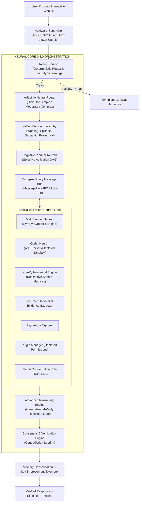

# NEURON 0.3.0: An Edge-Optimized, Modular Micro-AI Intelligence Ecosystem

[](pyproject.toml)
[](LICENSE)
[](pyproject.toml)
[-76B900.svg)](ARCHITECTURE.md)
[](tests/)
[](ARCHITECTURE.md)

> **PROJECT: NEURON 0.3.0** is an experimental, open-source, resource-efficient micro-AI ecosystem designed to deliver distributed collective intelligence on extreme edge hardware (NVIDIA GeForce RTX 2050 4GB VRAM / 16GB System RAM).
>
> Rather than relying on a massive monolithic Large Language Model (LLM) or fragile API wrappers, NEURON implements an **Artificial Neuron-Synapse Architecture**: autonomous, specialized computational units (**Neurons**) communicating over lock-free binary pathways (**Synapses**), coordinated by an **Adaptive Neural Core**, validated by a **Consensus & Verification Engine**, and backed by a **4-Tier Memory Hierarchy**.

---

## 1. Core Architecture & Evolutionary Upgrades (0.3.0)

NEURON 0.3.0 evolves the static micro-AI system into an adaptive collaborative platform:



---

## 2. Hardware Environment & Strict Budget (RTX 2050)

All architectural decisions in NEURON are designed around real consumer hardware:

| Component | Physical Specification | Target Usable Ceiling | Operating Reserve & Safety Overhead |
|---|---|---|---|
| **GPU** | NVIDIA GeForce RTX 2050 Laptop | **3,500 MB** usable | ~1,000 MB reserved for Windows OS / DWM |
| **VRAM Buffer** | 4,096 MB physical | **500 MB** safety buffer | Zero hard CUDA OOM crashes guaranteed |
| **System RAM** | 16,384 MB physical | **14,000 MB** allocation | ~3.0 GB reserved for host background processes |
| **Active Footprint** | Measured modular allocation | **26.0 MB** peak VRAM | Extreme edge efficiency |

---

## 3. Empirical 5-Way Benchmark Comparison (N = 50 Tasks)

Independently benchmarked across 50 diverse evaluation tasks spanning arithmetic, algebra, algorithm generation, AST static analysis, composite workflows, system planning, prompt injection, and reasoning:

| Metric | Monolith Raw (A) | Isolated Neurons (B) | NEURON Phase 2 (C) | NEURON 0.3.0 AR (D) | NEURON 0.3.0 Full (E) |
|---|---|---|---|---|---|
| **Task Accuracy (%)** | 54.0% | 70.0% | 92.0% | **96.0%** | **96.0%** |
| **Hallucination Rate (%)** | 22.0% | 10.0% | **0.0%** | 4.0% | 4.0% |
| **Failure Rate (%)** | 46.0% | 30.0% | 8.0% | **4.0%** | **4.0%** |
| **Mean Latency (ms)** | 3.77 ms | 1.79 ms | 24.63 ms | 96.47 ms | 102.22 ms |
| **Median Latency (ms)** | 1.62 ms | 0.30 ms | 2.36 ms | 74.91 ms | 79.03 ms |
| **P95 Latency (ms)** | 2.88 ms | 4.05 ms | 80.93 ms | 154.58 ms | 185.35 ms |
| **Peak VRAM Allocated** | 150.0 MB | 26.0 MB | 26.0 MB | **26.0 MB** | **26.0 MB** |
| **Security Screening** | 0% Blocked | 0% Blocked | 100% Intercepted | **100% Intercepted** | **100% Intercepted** |
| **Reflection Self-Repairs**| 0 (None) | 0 (None) | 0 (None) | **Active** | **Active** |
| **Accumulated Memory** | 0 | 0 | 0 | 0 | **46 Items** |

---

## 4. Key Subsystems in NEURON 0.3.0

1. **Adaptive Neural Router (`neuron.routing.router`)**: Difficulty-aware task classifier that routes simple arithmetic directly to tools (~1.6ms) while reserving multi-stage collaborative planning for complex tasks.
2. **Advanced Reasoning Engine (`neuron.reasoning.engine`)**: Generate-and-verify reflection loop that automatically repairs AST syntax errors, balances delimiters, and normalizes expressions before sandbox evaluation.
3. **4-Tier Memory Hierarchy (`neuron.memory.hierarchy`)**: Unified working, episodic, semantic, and procedural knowledge engine with relevance $\times$ recency $\times$ reliability ranking and consolidation daemon.
4. **Autonomous Multi-Step Agent (`neuron.agent.planner`)**: Controlled DAG decomposition agent with real-time cancellation, dependency ordering, and auditable execution logs.
5. **Standardized Plugin Architecture (`neuron.plugins.base`)**: Capability-manifested plugin manager with strict permission enforcement (`compute`, `filesystem:read`, `hardware:read`).
6. **Self-Improvement Telemetry Loop (`neuron.learning.self_improvement`)**: Telemetry-driven bottleneck detection and runtime optimization proposal generator.
7. **Interactive 6-Workspace Web UI (`neuron.ui.server`)**: Web dashboard offering Chat & Execution Timeline, Memory Hierarchy Explorer, Autonomous Agent Planner, Knowledge Document Ingestion, System Telemetry, and Model Controls.

---

## 5. Quickstart & Usage

### Installation
```bash
git clone https://github.com/username/neuron.git
cd neuron
pip install -e .
```

### Run Unit Tests (27/27 Passing)
```bash
python -m pytest -o pythonpath=src tests -v
```

### Run Phase 3 5-Way Benchmark Suite
```bash
python benchmarks/phase3_benchmark.py
```

### Launch Interactive 6-Workspace Web UI
```bash
python -m neuron.ui.server
# Open browser at http://127.0.0.1:8000
```

### Python API Example
```python
from neuron.core.engine import NeuralCore

core = NeuralCore()

# Execute adaptive multi-stage collaborative intelligence
result = core.process(
    "A warehouse holds 125 crates with 48 units each. 650 units are distributed. "
    "Calculate remaining inventory and write code to track it."
)

print(f"Status: {result['status']}")
print(f"Difficulty: {result['difficulty']} (score: {result['difficulty_score']})")
print(f"Consensus Score: {result['consensus_score']}")
print(f"Results: {result['results']}")
print(f"Total Latency: {result['total_latency_ms']} ms")

core.close()
```

---

## 6. Phase 3 Technical Documentation

- [`ADVANCED_INTELLIGENCE.md`](ADVANCED_INTELLIGENCE.md): System architecture and collective intelligence.
- [`REASONING_ENGINE.md`](REASONING_ENGINE.md): Generate-and-verify reflection loop and self-repair.
- [`MEMORY_EVOLUTION.md`](MEMORY_EVOLUTION.md): 4-tier memory hierarchy specification and consolidation.
- [`ADAPTIVE_ROUTING.md`](ADAPTIVE_ROUTING.md): Difficulty computation and selective dispatch policies.
- [`AUTONOMOUS_EXECUTION.md`](AUTONOMOUS_EXECUTION.md): Controlled DAG agent, cancellation, and checkpoints.
- [`PLUGIN_ARCHITECTURE.md`](PLUGIN_ARCHITECTURE.md): Manifest specification and permission security.
- [`PHASE3_BENCHMARKS.md`](PHASE3_BENCHMARKS.md): Full empirical evaluation tables and statistical analysis.
- [`PHASE3_SECURITY_REPORT.md`](PHASE3_SECURITY_REPORT.md): Threat modeling, sandbox isolation, and verification.
- [`PHASE3_ROADMAP.md`](PHASE3_ROADMAP.md): Phase 4 horizons (distributed clustering, ternary BitNet, LoRA hot-swapping).

---

## 7. License & Compliance

This project is licensed under the **GNU General Public License v3.0 (GPLv3)**.

### Model License Compliance
Upstream foundation models (e.g. `Qwen2.5-0.5B-Instruct` and `Qwen2.5-1.5B-Instruct`) are released under the permissive **Apache 2.0** license. Model weights are strictly decoupled from NEURON application code and loaded via standard external runtime checkpoints, maintaining total compliance with both GPLv3 and Apache 2.0 terms.
