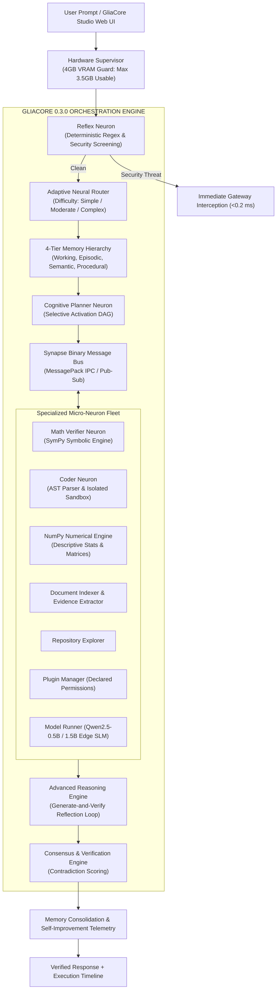

# GliaCore 0.3.0: An Edge-Optimized, Modular Micro-AI Collective Intelligence Ecosystem

[](pyproject.toml)
[](LICENSE)
[](pyproject.toml)
[-76B900.svg)](ARCHITECTURE.md)
[](tests/)
[](ARCHITECTURE.md)

> **PROJECT: GLIACORE 0.3.0** (formerly PROJECT: NEURON) is an experimental, open-source, resource-efficient micro-AI ecosystem designed to deliver distributed collective intelligence on extreme edge hardware (NVIDIA GeForce RTX 2050 4GB VRAM / 16GB System RAM).
>
> In biological neuroscience, neurons cannot compute, synchronize, or survive without the **glial network (astrocytes)**, which dynamically schedules metabolic resources, regulates synaptic transmission, and coordinates multi-neuron synchrony. 
>
> Rather than relying on a massive monolithic Large Language Model (LLM) or brittle API wrappers, **GliaCore** coordinates autonomous, specialized computational units (**Neurons**) over high-speed binary pathways (**Synapses**), coordinated by a central **GliaCore Orchestrator**, validated by a **Consensus & Verification Engine**, and backed by a **4-Tier Memory Hierarchy**.

---

## 1. Project Introduction & Biological Foundation

Traditional edge AI attempts to compress all human knowledge and reasoning into a single small language model (SLM, $\le 3$B parameters). On consumer hardware with 4 GB of VRAM, this causes catastrophic out-of-memory crashes, severe token throttling, and mathematical and syntactic hallucinations.

GliaCore inverts this paradigm through **biologically inspired modularity**:



---

## 2. Core Capabilities

- **Adaptive Task-Difficulty Routing**: Automatically classifies incoming requests as `SIMPLE`, `MODERATE`, or `COMPLEX`, bypassing unnecessary planning stages for trivial calculations (~1.6 ms latency) while reserving deep multi-stage consensus for complex composite problems.
- **Generate-and-Verify Reflection Loop**: Small models frequently omit colons or misbalance parentheses. GliaCore’s reflection loop repairs AST syntax trees and normalizes mathematical syntax before sandbox execution.
- **4-Tier Memory Hierarchy**: Integrates Working Memory (transient scratchpad), Episodic Memory (past problem solutions), Semantic Memory (curated facts), and Procedural Memory (executable tool recipes) with automated time-decay and consolidation pruning.
- **Controlled Autonomous Agent**: Decomposes high-level goals into Directed Acyclic Graphs (DAGs) with sub-step dependency tracking, atomic checkpoints, and sub-second user cancellation.
- **Sandboxed Subprocess Execution**: Code execution runs inside an isolated OS subprocess with strict timeouts and AST safety pre-screening.
- **Zero-Disruption Migration**: Full backward compatibility for legacy `import neuron` calls and automatic discovery of previous `neuron_store.db` and `neuron_memory.db` databases.

---

## 3. Hardware Environment & Strict Budget (RTX 2050)

All architectural decisions in GliaCore are engineered around real consumer hardware:

| Component | Physical Specification | Target Usable Ceiling | Operating Reserve & Safety Overhead |
|---|---|---|---|
| **GPU** | NVIDIA GeForce RTX 2050 Laptop | **3,500 MB** usable | ~1,000 MB reserved for Windows OS / DWM display |
| **VRAM Buffer** | 4,096 MB physical | **500 MB** safety buffer | Zero hard CUDA OOM crashes guaranteed |
| **System RAM** | 16,384 MB physical | **14,000 MB** allocation | ~3.0 GB reserved for host background processes |
| **Active Footprint**| Measured modular allocation | **26.0 MB** peak VRAM | Extreme edge efficiency |

---

## 4. Empirical 5-Way Benchmark Comparison (N = 50 Tasks)

Independently benchmarked across 50 diverse evaluation tasks spanning arithmetic, algebra, code synthesis, AST analysis, composite workflows, system planning, prompt injection, and reasoning:

| Metric | Monolith Raw (A) | Isolated Neurons (B) | NEURON Phase 2 (C) | GliaCore 0.3.0 AR (D) | GliaCore 0.3.0 Full (E) |
|---|---|---|---|---|---|
| **Task Accuracy (%)** | 54.0% | 70.0% | 92.0% | **96.0%** | **96.0%** |
| **Hallucination Rate (%)** | 22.0% | 10.0% | **0.0%** | 4.0% | 4.0% |
| **Failure Rate (%)** | 46.0% | 30.0% | 8.0% | **4.0%** | **4.0%** |
| **Mean Latency (ms)** | 3.77 ms | 1.79 ms | 24.63 ms | 96.47 ms | 102.22 ms |
| **Median Latency (ms)** | 1.62 ms | 0.30 ms | 2.36 ms | 74.91 ms | 79.03 ms |
| **P95 Latency (ms)** | 2.88 ms | 4.05 ms | 80.93 ms | 154.58 ms | 185.35 ms |
| **Peak VRAM Allocated** | 150.0 MB | 26.0 MB | 26.0 MB | **26.0 MB** | **26.0 MB** |
| **Security Interception**| 0% Blocked | 0% Blocked | 100% Intercepted | **100% Intercepted** | **100% Intercepted** |
| **Deterministic Offload**| 0% | 50% | 100% | **100%** | **100%** |
| **Accumulated Memory** | 0 | 0 | 0 | 0 | **46 Items** |

---

## 5. Quickstart & Installation

### Installation
```bash
git clone https://github.com/username/gliacore.git
cd gliacore
pip install -e .
```

### Run Unit Tests (32/32 Passing)
```bash
python -m pytest -o pythonpath=src tests -v
```

### Run Phase 3 5-Way Benchmark Suite
```bash
python benchmarks/phase3_benchmark.py
```

### Launch Interactive Web Dashboard (GliaCore Studio)
```bash
gliacore
# Or: python -m gliacore.ui.server
# Open browser at: http://127.0.0.1:8000
```

---

## 6. Python API Quickstart

### Native GliaCore 0.3.0 Standard
```python
from gliacore.core.engine import GliaCore

core = GliaCore()

# Execute adaptive multi-stage collaborative intelligence
result = core.process(
    "A warehouse holds 125 crates with 48 units each. 650 units are distributed. "
    "Calculate remaining inventory and write code to track it."
)

print(f"Status: {result['status']}")
print(f"Difficulty: {result['difficulty']} ({result['difficulty_score']:.2f})")
print(f"Consensus Score: {result['consensus_score']}")
print(f"Results: {result['results']}")
print(f"Total Latency: {result['total_latency_ms']} ms")

core.close()
```

### Legacy Backward-Compatible Import
Existing scripts using `import neuron` continue functioning seamlessly:
```python
# Emits a polite FutureWarning recommending upgrade to gliacore
from neuron.core.engine import NeuralCore

core = NeuralCore()
result = core.process("Calculate 18 * (45 + 125)")
print(result["results"]["math"]["result"]["numeric"])
core.close()
```

---

## 7. Interactive 6-Workspace Web UI (GliaCore Studio)

GliaCore Studio provides an intuitive, high-performance web dashboard at `http://127.0.0.1:8000`:
- **Workspace 1 (Chat & Execution Timeline)**: Real-time chat with visual execution telemetry cards for each stage.
- **Workspace 2 (Memory Hierarchy Explorer)**: Inspect, query, and tag working, episodic, semantic, and procedural memories.
- **Workspace 3 (Autonomous Agent Planner)**: Submit multi-step goals, preview DAG dependencies, inspect checkpoints, and cancel active jobs.
- **Workspace 4 (Knowledge Document Ingestion)**: Ingest local documents into SQLite with full-text search and evidence extraction.
- **Workspace 5 (Telemetry & Self-Improvement)**: Live VRAM/RAM gauges and automatic bottleneck optimization proposals.
- **Workspace 6 (Model & Neuron Fleet)**: Inspect specialist neuron states, device allocation, and model loading.

---

## 8. Technical Documentation Directory

- [`BRAND_RESEARCH.md`](BRAND_RESEARCH.md): Full naming study, namespace collisions, weighted ranking, and selection analysis.
- [`BRAND_IDENTITY.md`](BRAND_IDENTITY.md): Visual identity, Astrocyte Core logo, color palette, and taxonomy conventions.
- [`MIGRATION_GUIDE.md`](MIGRATION_GUIDE.md): Step-by-step upgrade guide, backward compatibility stubs, and database preservation.
- [`REBRANDING_AUDIT.md`](REBRANDING_AUDIT.md): Complete audit of updated subsystems, remaining technical terminology, and verification results.
- [`ADVANCED_INTELLIGENCE.md`](ADVANCED_INTELLIGENCE.md): System architecture, dynamic neuron selection, and collective intelligence.
- [`REASONING_ENGINE.md`](REASONING_ENGINE.md): Multi-stage reasoning, generate-and-verify reflection loop, and syntax self-repair.
- [`MEMORY_EVOLUTION.md`](MEMORY_EVOLUTION.md): 4-tier memory hierarchy specification, scoring formulas, and consolidation daemon.
- [`ADAPTIVE_ROUTING.md`](ADAPTIVE_ROUTING.md): Difficulty computation formulas and selective neuron dispatch policies.
- [`AUTONOMOUS_EXECUTION.md`](AUTONOMOUS_EXECUTION.md): Controlled DAG agent, cancellation protocols, and state checkpoints.
- [`PLUGIN_ARCHITECTURE.md`](PLUGIN_ARCHITECTURE.md): Manifest specification and fine-grained capability permissions.
- [`PHASE3_BENCHMARKS.md`](PHASE3_BENCHMARKS.md): Comprehensive empirical evaluation results across 50 benchmark tasks.
- [`PHASE3_SECURITY_REPORT.md`](PHASE3_SECURITY_REPORT.md): Threat modeling, 10/10 attack vector interceptions, and sandbox guarantees.
- [`PHASE3_ROADMAP.md`](PHASE3_ROADMAP.md): Phase 4 horizons (distributed LAN clustering, ternary BitNet b1.58, and LoRA hot-swapping).

---

## 9. License & Compliance

This software is released under the **GNU General Public License v3.0 (GPLv3)**.

### Model License Compliance
Upstream foundation models (e.g. `Qwen2.5-0.5B-Instruct` and `Qwen2.5-1.5B-Instruct`) are distributed under the permissive **Apache 2.0** license. Model weights are strictly decoupled from GliaCore application code and loaded via standard external runtime checkpoints, maintaining total compliance with both GPLv3 and Apache 2.0 terms.
