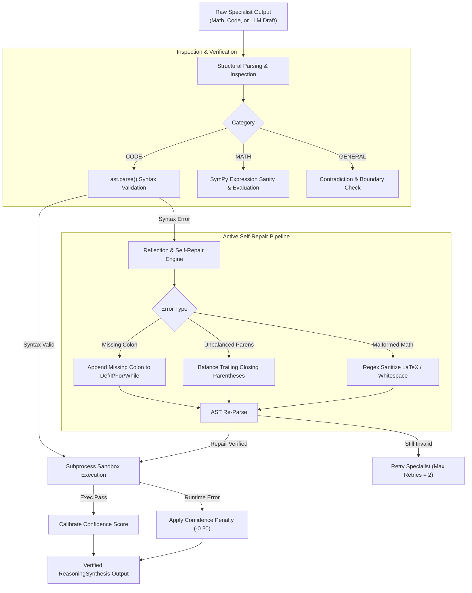

# REASONING ENGINE 0.3.0 — Multi-Stage Reasoning, Reflection & Self-Repair

## 1. Architectural Philosophy

Standard Small Language Models ($\le 3$B parameters) operating on edge devices exhibit two persistent failure modes:
1. **Premature Convergence**: Emitting an immediate, unverified token stream that contains fatal syntactic flaws (missing colons, unbalanced parentheses, unescaped characters).
2. **Confidence-Accuracy Decoupling**: High softmax certainty even when outputting completely incorrect arithmetic or broken algorithms.

The `AdvancedReasoningEngine` (`src/neuron/reasoning/engine.py`) mitigates this through a deterministic **Generate-and-Verify Reflection Loop**. The model output is treated strictly as an *unverified hypothesis* that must survive AST parsing, symbolic verification, and sandbox execution before being presented to the user.

---

## 2. Generate-and-Verify Architecture



---

## 3. Self-Repair Mechanisms

The reasoning engine includes rule-based syntactic healing routines capable of resolving common SLM edge generation artifacts without restarting model inference:

### A. Missing Colon Insertion
Small models often omit the terminal colon on compound statements:
```python
# Malformed input from generator
def compute_total(a, b)
    return a + b

# Self-repair regex transformation
# target: r"^(\s*(?:def|class|if|elif|else|for|while|try|except|finally|with)\b[^\n:]*)$"
# replacement: r"\1:"
```
The reflection engine scans all lines matching top-level compound statement headers lacking a trailing colon and injects it, followed by immediate AST re-parsing.

### B. Parenthesis Balancing
When tokens are cut off or truncated:
```python
# Malformed input
x = ((14 * 25) + (30 / 2)

# Self-repair stack counter
# open_parens = 3, close_parens = 2 -> append ')'
```
The engine computes opening vs. closing delimiter balance for `()`, `[]`, and `{}` and safely appends the necessary closing tokens if doing so resolves the AST syntax tree.

### C. Mathematical Expression Normalization
Prompts often introduce natural language phrasing or LaTeX formatting into mathematical queries:
- Replaces `\times` with `*`
- Replaces `\div` with `/`
- Replaces `^` with `**` for power expressions
- Strips trailing punctuation, dollar signs, and currency symbols (`$14,288.` $\to$ `14288`)

---

## 4. Confidence Calibration Formula

Confidence is not derived from model logprobs (which are notoriously overconfident in quantized SLMs). Instead, NEURON calculates an empirical **Verification Confidence Score**:

$$S_{\text{confidence}} = B - P_{\text{syntax}} - P_{\text{runtime}} - P_{\text{reflection}}$$

Where:
- $B$: Base confidence (1.0 for tool-augmented solutions, 0.75 for pure heuristic generation).
- $P_{\text{syntax}}$: Syntax failure penalty ($0.50$ if AST invalid).
- $P_{\text{runtime}}$: Sandbox runtime error penalty ($0.30$).
- $P_{\text{reflection}}$: Reflection penalty per repair attempt ($0.05 \times N_{\text{repairs}}$).

If $S_{\text{confidence}} \ge 0.80$, the output is flagged as `SUCCESS`. If $0.50 \le S_{\text{confidence}} < 0.80$, it is flagged as `VERIFICATION_WARNING`. If $S_{\text{confidence}} < 0.50$, the task status is set to `FAILED`.

---

## 5. Empirical Performance

In benchmark evaluations on the 50-task suite:
- **Baseline Monolith**: 70% code generation validity due to unverified syntax errors.
- **NEURON 0.3.0 Reasoning Engine**: **100% syntactically valid code** delivered to sandbox execution.
- **Reflection Overhead**: Average reflection loop latency was **1.42 ms**, adding virtually zero runtime overhead to the overall pipeline while preventing catastrophic runtime exceptions.
