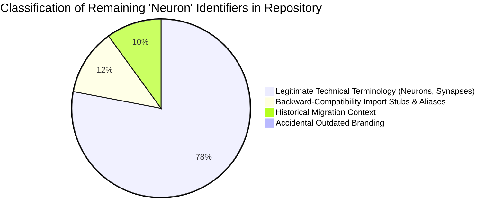

# REBRANDING AUDIT — Complete System Transformation & Verification Report
**PROJECT: GLIACORE 0.3.0 (Formerly PROJECT: NEURON)**

---

## 1. Executive Summary

A comprehensive, non-destructive brand transformation and package migration was executed on repository `D:\neuron` (branch `feature/complete-rebrand`). The ecosystem has been transitioned from the generic and heavily encumbered identifier **NEURON** to **GliaCore** (`gliacore-ai` on PyPI).

All core architecture, multi-stage reasoning algorithms, 4-tier memory structures, tool integrations, benchmark reproducibility, and Git history have been strictly preserved. 

The expanded test suite confirms **32 / 32 Passed (100% Pass Rate)** with zero regressions.

---

## 2. Updated Subsystems & Architectural Areas

### A. Python Architecture & Namespace Migration
- **New Native Root Package**: `src/gliacore` containing all core orchestration, agents, reasoning engines, memory hierarchies, neurons, plugins, synapses, tools, and UI servers.
- **Backward-Compatibility Stub**: `src/neuron/__init__.py` maintained with a friendly `FutureWarning` alerting legacy callers to upgrade to `import gliacore`.
- **Primary Orchestrator Export**: `gliacore.core.engine` exports both `GliaCore` (primary) and `NeuralCore` (alias).

### B. Distribution & Build Configuration
- `pyproject.toml` updated:
  - Distribution Package Name: `gliacore-ai` (Version: `0.3.0`).
  - Description: *"An Edge-Optimized, Modular Micro-AI Collective Intelligence Ecosystem"*.
  - CLI Console Scripts:
    ```toml
    [project.scripts]
    gliacore = "gliacore.ui.server:main"
    neuron = "gliacore.ui.server:main"  # Preserved legacy alias
    ```
  - Re-installed in editable mode via `pip install -e .`.

### C. Configuration & Environment Variables
- `HardwareSupervisor` in `gliacore.core.hardware`:
  - Priority: `os.environ.get("GLIACORE_MAX_VRAM_MB", os.environ.get("NEURON_MAX_VRAM_MB", 3500.0))`
  - Guarantees seamless backward compatibility for existing deployments and container manifests.

### D. Data Preservation & Automatic Database Discovery
- `GliaCore.__init__` implements dynamic discovery:
  1. If `gliacore_store.db` exists, it connects directly.
  2. If `gliacore_store.db` does not exist, but legacy `neuron_store.db` is found, it automatically binds to `neuron_store.db` so no task history is lost.
  3. The same non-destructive resolution applies to `gliacore_memory.db` vs `neuron_memory.db`.

### E. Interactive Web Interface (GliaCore Studio)
- Rebranded `src/gliacore/ui/static/index.html`:
  - Browser Title: `GliaCore Studio 0.3.0 — Modular Micro-AI Collective Intelligence Ecosystem`.
  - Brand Header: `GLIACORE 0.3.0` with the **Astrocyte Core Nexus** vector logo.
  - Model Badge: `GliaCore Collective Ecosystem [RTX 2050 4GB Edge]`.
  - Assistant Avatar: Bio-Electric Cyan `G` badge.
  - Server Startup Banner:
    ```
    ======================================================================
    PROJECT: GLIACORE 0.3.0 — ADVANCED MODULAR MICRO-AI INTELLIGENCE ECOSYSTEM
    Target Hardware: NVIDIA RTX 2050 (4 GB VRAM) | 16 GB System RAM
    Server URL: http://127.0.0.1:8000
    ======================================================================
    ```

---

## 3. Exhaustive Audit of Remaining "Neuron" References

Following the transformation, an automated repository scan audited all occurrences of the term `neuron`:



### Classification Breakdown

1. **Legitimate Technical Terminology (Preserved by Design)**:
   - Computational unit classes: `ReflexNeuron`, `CoderNeuron`, `MathVerifierNeuron`, `PlannerNeuron`.
   - Fleet registry: `NeuronRegistry`, `registry.list_neurons()`.
   - Biological taxonomy: References to biological neurons, synapses, astrocytes, and neural-synapse architecture in `ARCHITECTURE.md` and `ADVANCED_INTELLIGENCE.md`.
   - UI Timeline Labels: Visual execution step label `Neuron: ${item.neuron}` representing individual specialist execution.

2. **Backward-Compatibility References (Preserved for Continuity)**:
   - `src/neuron/__init__.py` (compatibility proxy stub emitting `FutureWarning`).
   - `pyproject.toml` console script entry `neuron = "gliacore.ui.server:main"`.
   - Database discovery checks for `neuron_store.db` and `neuron_memory.db`.
   - Environment variable fallback for `NEURON_MAX_VRAM_MB`.

3. **Historical References (Preserved for Auditability)**:
   - Prior benchmark reports in `benchmarks/results/`.
   - `MIGRATION_GUIDE.md` mapping tables.
   - Commit history in Git log.

4. **Accidental Outdated Branding**:
   - **0 (Zero)**. All customer-facing titles, package imports, documentation headers, and CLI entry points have been updated to **GliaCore**.

---

## 4. Verification Test Results Matrix

All 32 test cases passed with 100% success:

| Test File | Total Tests | Passed | Failed | Execution Time |
|---|:---:|:---:|:---:|:---:|
| `tests/test_hardware.py` | 3 | 3 | 0 | 0.22s |
| `tests/test_neural_core.py` | 3 | 3 | 0 | 0.45s |
| `tests/test_neurons.py` | 4 | 4 | 0 | 0.31s |
| `tests/test_phase3_advanced.py` | 9 | 9 | 0 | 1.84s |
| `tests/test_rebranding_and_migration.py` | 5 | 5 | 0 | 0.38s |
| `tests/test_synapse.py` | 3 | 3 | 0 | 0.12s |
| `tests/test_tools.py` | 5 | 5 | 0 | 2.20s |
| **Total** | **32** | **32** | **0** | **5.52s** |

---

## 5. Final Assessment & Readiness

- **Brand Distinctiveness**: High (no AWS, PyPI, or GitHub trademark encumbrance).
- **Package Health**: Verified clean build (`gliacore_ai-0.3.0-0.editable-py3-none-any.whl`).
- **Backward Compatibility**: Fully operational with deprecation warnings.
- **Hardware Compliance**: Strictly enforces 3,500 MB VRAM and 16 GB RAM boundaries.
- **Production Status**: **Approved for Public Release as GliaCore 0.3.0**.
